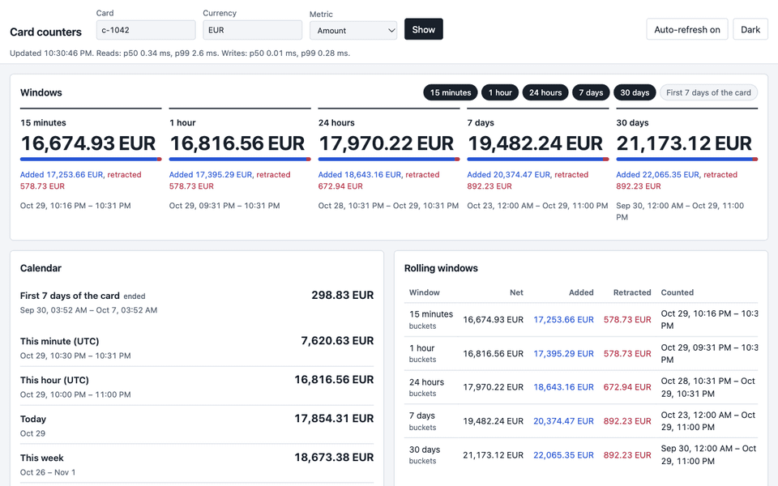
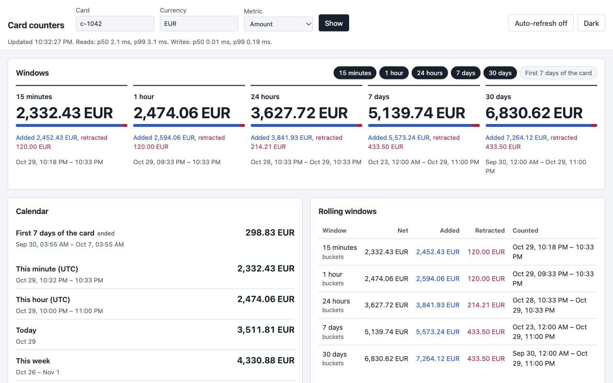
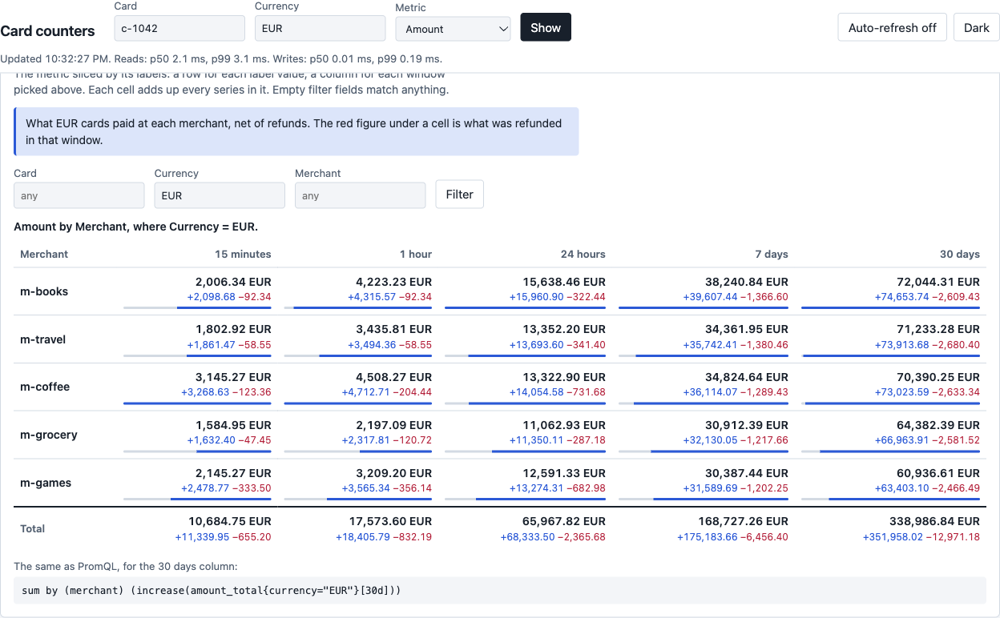
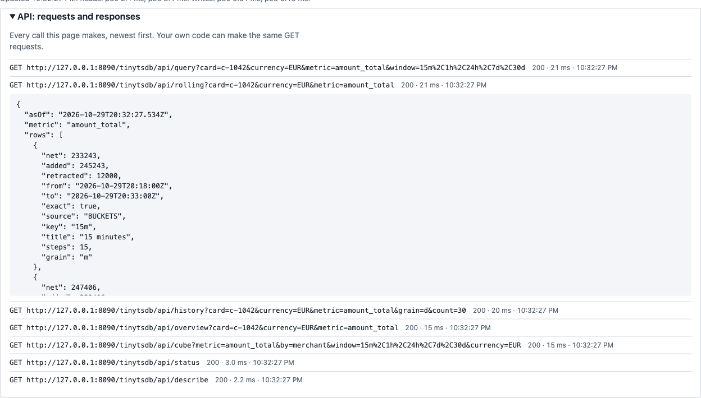
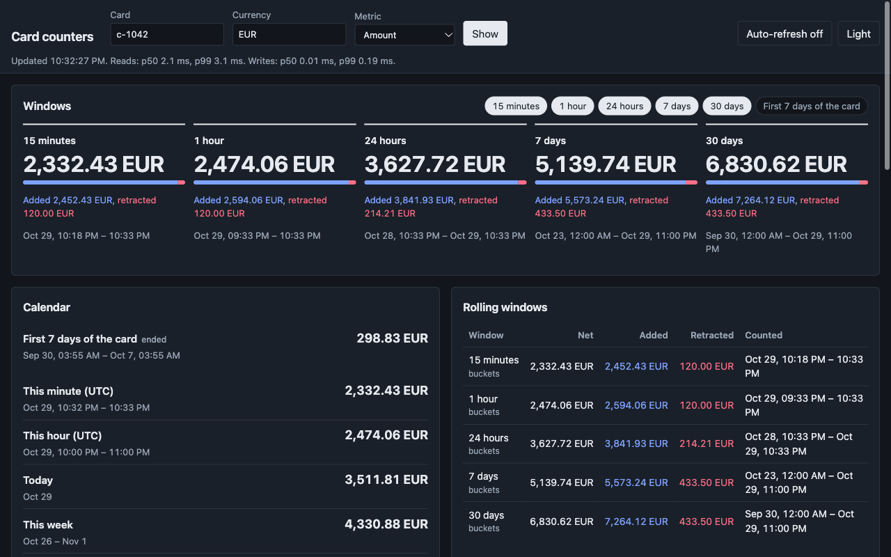
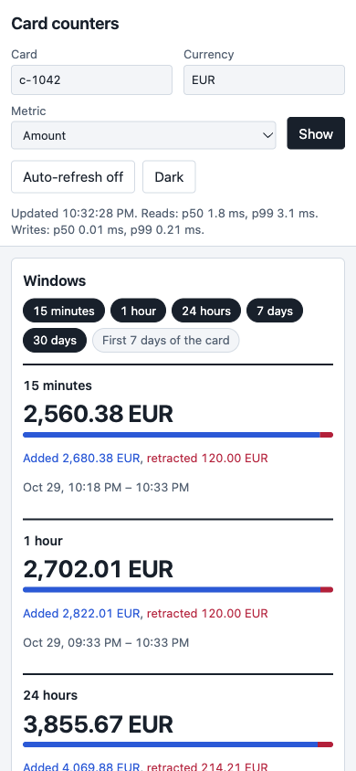

# tinytsdb

In-process counters with labels, kept per time bucket and read over calendar, rolling, anchored or arbitrary
windows. On top: a subset of PromQL, and a read-only web console that slices the counters like a cube. One jar,
Java 25, no dependencies.

It is meant for counts that a request has to know *now*, for example "how many of this user's payments are pending
in the last 10 minutes" or "how much this card spent this month". The goal is to answer those without a round trip to
a database or to Prometheus, or, with a remote store, in one round trip.



## Install

One artifact, `io.github.skippedaga:tinytsdb`, holds the library and the console. Each
[GitHub release](https://github.com/skippedaga/tinytsdb/releases) has the jar, its sources and javadoc jars, the pom
and `SHA256SUMS`. Publishing to Maven Central is set up (see [Build](#build)); once it is there:

```xml
<dependency>
    <groupId>io.github.skippedaga</groupId>
    <artifactId>tinytsdb</artifactId>
    <version>0.3.0</version>
</dependency>
```

## Examples

Every example below is in [`ReadmeExamplesTest`](src/test/java/io/github/skippedaga/tinytsdb/ReadmeExamplesTest.java),
so it compiles and gives these numbers.

**Set up.** Tiers are the bucket sizes you keep, and for how long.

```java
TinyTsdb db = TinyTsdb.builder()
        .zone(ZoneId.of("Europe/Kyiv"))              // days, weeks and months start at local midnight
        .tier(Grain.MINUTE, Duration.ofHours(48))
        .tier(Grain.HOUR, Duration.ofDays(62))
        .tier(Grain.DAY, Duration.ofDays(3 * 365))
        .build();
```

**A refund is a retraction, not a smaller number.** Amounts are integers in minor units.

```java
Labels card = Labels.of("card", "c1", "currency", "EUR");
db.add("amount_total", card, paidAtMs, 12_50);       // a payment
db.add("amount_total", card, paidAtMs, -4_00);       // a partial refund, at the payment's time

Reading month = db.read("amount_total", card, Window.calendar("mo:2026-10"));
month.net();         // 850
month.added();       // 1250
month.retracted();   // 400
```

**A status change is two writes,** both at the payment's own time, so every window stays right.

```java
db.write(List.of(
        Increment.of("tx_total", user.with("status", "PENDING"), paidAtMs, -1),
        Increment.of("tx_total", user.with("status", "DECLINED"), paidAtMs, 1)));

Window last10m = Window.rolling(Duration.ofMinutes(10), Grain.MINUTE);
db.read("tx_total", user.with("status", "PENDING"), last10m).net();    // 0, with retracted 1
db.read("tx_total", user.with("status", "DECLINED"), last10m).net();   // 1
```

**A cube in code:** one call groups by a label over several windows.

```java
List<Window> windows = List.of(Window.rolling(Duration.ofHours(1), Grain.MINUTE),
        Window.rolling(Duration.ofDays(1), Grain.MINUTE));
Map<Window, Map<Labels, Reading>> cube =
        db.readGrouped("payments_total", List.of(), List.of("merchant"), windows, nowMs);

cube.get(windows.get(0)).get(Labels.of("merchant", "m-books")).net();   // 2: a row per merchant, a column per window
```

**The same column in PromQL:**

```java
db.query("sum by (merchant) (increase(payments_total[1d]))").vector();
```

**Consuming a log at most once.** `applyAt` keeps the offset per series, so a redelivered or replayed record changes
nothing, even after a write that failed halfway.

```java
db.applyAt("payments-3", 1_207, increments).applied();   // 1
db.applyAt("payments-3", 1_207, increments).applied();   // 0
```

## Concepts

**Series.** A series is a metric name plus labels (`Labels`, sorted, immutable; an empty value means no label).

**PN counters, integers only.** Every bucket holds two parts that only grow (`Parts`):
- a positive delta adds to `added`;
- a negative delta adds to `retracted`;
- `net = added − retracted`.

Amounts go in as minor units, never as floating point. A status flip from approved to declined is two writes, −1 on
one counter and +1 on the other, both at the event's original time.

**Event time.** A write lands in the bucket of `occurredAtMs`, not of its arrival. A correction that arrives months
later goes back to the event's day, month and year buckets, as long as those tiers still keep that period. All time
(`Grain.ALL`) always counts it.

**Grains and tiers.** Grains:

| Grain | Time zone | Bucket id |
|---|---|---|
| second | UTC | `s:2026-10-29T13:05:07` |
| minute | UTC | `m:2026-10-29T13:05` |
| hour | UTC | `h:2026-10-29T13` |
| day | the store's zone | `d:2026-10-29` |
| ISO week | the store's zone | `w:2026-W44` |
| month | the store's zone | `mo:2026-10` |
| year | the store's zone | `y:2026` |
| all time | — | `all` |

Days, weeks, months and years start at local midnight, so a DST day is 23 or 25 hours long. Every id parses back to
its `[start, end)` with `Grain.parse`. A *tier* is a grain plus a retention. Configure only the tiers you read.

**Windows.**

| Window | Covers | Exactness |
|---|---|---|
| `Window.calendar("d:2026-10-29")` | one bucket | exact |
| `Window.rolling(7, Grain.DAY)`, `Window.rolling(Duration.ofMinutes(5), Grain.MINUTE)` | the last N steps, including the one in progress: `[start of (current − (N−1)), end of current)` | exact to the step; zoned steps are calendar steps |
| `Window.range(from, to)` | `[from, to)`, built from the coarsest whole buckets that fit, with finer ones at the edges | `exact = false` when an edge falls inside the finest bucket kept there; that part is left out, never double-counted |
| `Window.anchored("approved_total", Duration.ofDays(7))` | a fixed length from the series' first positive event of the anchor metric (same labels), from the start of the finest bucket holding it | a late, earlier event moves the anchor back; with `recomputeOnRetraction`, a reversed anchor moves forward to the first bucket that still has a positive net value |
| `Window.allTime()` | everything | exact |

Every `Reading` carries `net`, `added`, `retracted`, the `[from, to)` it counted, `asOf`, `exact`, and its `source`
(the buckets, or a stored rolling aggregate). Reads take several windows at once:
- `read(metric, labels, windows, asOf)`;
- `readGrouped(metric, matchers, groupBy, windows, asOf)` sums series per value of the grouping labels.

**Idempotency, two ways:**
- `applyOnce(key, increments)` writes a batch at most once per key. The key is yours, for example
  `paymentId:STATE:version`. The claim lasts `claimTtl` (7 days by default), so keep it at least as long as your
  source log's retention. `releaseClaim(key)` undoes it after your own processing failed.
- `applyAt(stream, offset, increments)` writes each series at most once per stream offset (a Kafka partition, a
  log). A retry after a partial failure writes only the series that didn't take it, and a replay of old offsets
  changes nothing.

## Storage SPI

`CounterStore` is the core every store implements:
- `apply` (atomic per batch, or per series: `atomicity()`), `claim`;
- bulk reads with `readMany`;
- the first-added anchor, the series version, stored rolling aggregates.

Optional capabilities:

| Capability | Gives | Without it |
|---|---|---|
| `RangeStore` | sums and lists a range of buckets itself | TinyTsdb lists the bucket keys and reads every window of every series in one `readMany` |
| `IndexedStore` | series by label matchers, label values | selectors and grouped reads must name a series exactly (`=` on every label) |
| `MaintainableStore` | expiry run by `maintain()` | `maintain()` does nothing; the store prunes on write or by TTL |
| `ExportableStore` | `export` and `mergeMaxSink`, for `rebuildFrom` | no rebuild |

`MemoryCounterStore` has them all, plus a binary snapshot format (`writeSnapshot` / `readSnapshot`, which also reads
0.1 snapshots; wrap the stream in gzip yourself).

A remote key-value store, say Redis Cluster with one key per series, can implement just the core with
`Atomicity.SERIES`:
- Every write of one series is one atomic call, with the stream offset compared and set inside it.
- `StorageKey` splits labels into a key and a field, so all metrics, currencies and statuses of a card share one hash.

**Merging.** `rebuildFrom(coldStore)` merges stores: max per part and per offset, earliest anchor, union of claims.
That is exact only when every copy applied each event at most once, so that one copy's events are a subset of the
other's. It is not a general multi-writer CRDT.

**Rolling snapshots.** With `ringSnapshots(true)` the library keeps, per series and rolling window, the aggregate of
its buckets.
- It is created lazily on the first read.
- Writes into the window patch it.
- A later read moves it forward by up to 4 steps (subtracting the buckets that left); further behind, it is recomputed.
- A version check keeps a read computed before a concurrent write from storing a stale aggregate.

This pays off with a remote store. The memory store sums its sparse buckets fast enough, so it is off by default.

**Label transforms.** `transform("card", LabelTransform.hmac(key, "tx_"))` rewrites a value before anything is stored,
so raw identifiers never reach the store. Reads and `=` / `!=` matchers go through the same transform. Transforms:

| Transform | Effect |
|---|---|
| `none` | unchanged |
| `upper` | upper case, root locale |
| `prefix:N` | the first N characters |
| `bucket:N` | a number floored to a multiple of N; a value that is not a number drops the label |
| `hmac` | HMAC-SHA256 with your key, base64url without padding, with your prefix |
| `hmac:keep` | as `hmac`, but a value that is already your prefix plus 43 base64url characters passes through, for inputs that may arrive hashed |

**Cardinality.** `CardinalityRule.cap("card", 100_000)` writes new values beyond the cap as `__overflow__`, so counts
are kept but not attributed. `CardinalityRule.idle("card", Duration.ofDays(30))` removes series idle for 30 days whole,
totals included.

**Also included:**
- `P2Quantile`: the P² streaming quantile estimate (Jain & Chlamtac), five markers and O(1) per sample, within 2% of the
  true rank on 10,000 samples in the tests. Up to five samples it is exact, interpolated between ranks (Hyndman & Fan
  type 7). `add` rejects NaN and infinities; `offer` drops them and says so. Not thread-safe.
- `TsdbListener`: hooks for write and read timings, duplicates, rolling-snapshot outcomes and overflows. Label values
  never reach a hook.

## The PromQL subset

| | |
|---|---|
| Selectors | `name{a="x", b!="y", c=~"re", d!~"re"}`, `{__name__=~"tx_.*"}`; regexes are Java's, anchored |
| Range functions | `increase(s[5m])` (net), `added(s[5m])`, `retracted(s[5m])` — a rolling window at the finest second/minute/hour tier whose step divides the range |
| Aggregations | `sum`, `count`, `min`, `max`, `avg`, with `by (…)` or `without (…)` before or after the argument |
| Operators | `+ - * /`, `== != > < >= <=` (filters, or 0/1 with `bool`), `and or unless`, `on (…)` / `ignoring (…)`, unary minus, parentheses |
| Instant selector | the series' all-time net value |

How it differs from Prometheus:
- `increase()` is exact, with no extrapolation.
- A series with nothing in the window is absent, not 0.
- A range no tier divides is refused, not approximated.
- Not supported: `rate`, other functions, `offset`, `@`, subqueries, `group_left` / `group_right`, `topk` and other
  parameterised aggregations, histograms.

## Console

A read-only page in the same jar, for the people who run the counters:
- the windows of one series, with the added / retracted split;
- the current calendar buckets and anchored windows;
- a rolling-window table that says where each value came from;
- a day or hour history, added above the axis and retracted below;
- the **cube**: the metric sliced by its labels, with ready-made examples;
- every API request the page makes, with its response;
- a status strip with read and write latencies (P², from `ConsoleMetrics`).

It has light and dark themes, works at phone width and from the keyboard, and keeps its state in the URL, so a view
can be shared as a link.



### The cube

Every counter is a cube: a metric, its labels, and time. The cube panel shows it as a table. Each label value gets a
row (one or two labels deep), each window picked above gets a column, and each cell adds up every series in it,
added and retracted shown apart. Filter on any label; an empty field matches anything. Under the table is the same
question in PromQL, when one gives exactly the same numbers.



Amounts are never added across currencies. When the cells would mix them, the page says so, and grouped by currency,
the total stays empty.

**Examples** are slices the product thinks worth knowing, each with a sentence on what to look for. Picking one sets
the metric, rows and filter; changing any of them by hand drops the explanation, since it no longer describes the
table.

### API box

At the bottom, a closed box lists every call the page makes, newest first: the full URL, status, time, and the
response when opened. While a response is open, newer calls wait, so it does not move while you read it.



| Dark | Phone |
|---|---|
|  |  |

### Turning it on

The console is **off by default**. Wiring it in exposes nothing until `enabled(true)`. While it is off, `serve`
opens no port, and the handler and `ConsoleApi.handle` answer 404 to everything. So it can be wired unconditionally
and switched from your configuration:

```java
ConsoleMetrics metrics = new ConsoleMetrics();                 // register as the TinyTsdb listener
TinyTsdb db = TinyTsdb.builder().listener(metrics).build();
ConsoleConfig config = ConsoleConfig.builder()
        .enabled(settings.consoleEnabled())                    // off unless your setting says so
        .title("Card counters")
        .metric(ConsoleConfig.Metric.count("n_total", "Payments"))
        .metric(ConsoleConfig.Metric.amount("amount_total", "Amount", "currency"))
        .seriesLabel("card").seriesLabel("currency")           // the labels that pick one series
        .browseLabel("merchant")                               // more labels the cube can slice by
        .anchored("first7d", "First 7 days of the card", "n_ok_total", Duration.ofDays(7))
        .example("Spend by merchant, EUR",
                "What EUR cards paid at each merchant, net of refunds.",
                "amount_total", List.of("merchant"), Map.of("currency", "EUR"))
        .text("label_card", "Card")                            // every word on the page can be replaced
        .build();
ConsoleApi api = new ConsoleApi(db, config, metrics);

// standalone, on the JDK's HttpServer; empty when the console is off
Optional<HttpServer> server = ConsoleHttpHandler.serve(api, new InetSocketAddress(8090), "/tinytsdb",
        exchange -> isAllowed(exchange));

// or from your framework's controller: api.handle("GET", "cube", params) returns status, content type and JSON,
// and the three static files are on the classpath under /tinytsdb/console/
```

Try it with the demo in the tests, made-up card payments with a payment every 400 ms:

```bash
mvn -q test-compile
java -cp target/classes:target/test-classes io.github.skippedaga.tinytsdb.console.ConsoleDemo 8090
# http://127.0.0.1:8090/tinytsdb/#card=c-1042&currency=EUR
```

### The JSON API

GET only. A series is picked by the configured series labels, and the page sums every series that has them.

| Endpoint | Answers |
|---|---|
| `describe` | what the page shows: metrics, labels, windows, tiers, examples, wording |
| `query?metric=&window=&<labels>` | every metric over every window |
| `overview` | anchored windows, current calendar buckets, all time |
| `rolling` | every rolling preset, with where its value came from |
| `history?grain=d\|h&count=` | the last buckets of a grain |
| `cube?metric=&by=a[,b]&window=&<filters>&top=` | grouped by one or two labels, a column per window; needs an `IndexedStore` |
| `labels?label=&top=` | top values of one label, today and all time; needs an `IndexedStore` |
| `promql?query=` | in Prometheus' `/api/v1/query` shape |
| `status` | as of, store capabilities, latencies |

A cube request and its answer, from the demo, cut to two rows:

```
GET /tinytsdb/api/cube?metric=amount_total&by=merchant&window=1h,24h&currency=EUR&top=2
```

```json
{
  "asOf": "2026-10-29T20:34:48.187Z",
  "metric": "amount_total",
  "by": ["merchant"],
  "filter": {"currency": "EUR"},
  "dimensions": ["card", "currency", "merchant"],
  "currencies": ["EUR"],
  "columns": [
    {"window": "1h", "title": "1 hour", "promql": "sum by (merchant) (increase(amount_total{currency=\"EUR\"}[1h]))"},
    {"window": "24h", "title": "24 hours", "promql": "sum by (merchant) (increase(amount_total{currency=\"EUR\"}[1d]))"}
  ],
  "groups": 5,
  "rows": [
    {
      "labels": {"merchant": "m-books"},
      "cells": [
        {"net": 863495, "added": 878166, "retracted": 14671},
        {"net": 2038286, "added": 2075967, "retracted": 37681}
      ]
    },
    {
      "labels": {"merchant": "m-travel"},
      "cells": [
        {"net": 1041623, "added": 1073783, "retracted": 32160},
        {"net": 2033262, "added": 2093707, "retracted": 60445}
      ]
    }
  ],
  "total": [
    {"net": 4891510, "added": 5077126, "retracted": 185616},
    {"net": 9781453, "added": 10120418, "retracted": 338965}
  ]
}
```

One series over two windows:

```
GET /tinytsdb/api/query?metric=n_total&window=15m,30d&card=c-1042&currency=EUR
```

```json
{
  "asOf": "2026-10-29T20:34:48.200Z",
  "series": {"card": "c-1042", "currency": "EUR"},
  "items": [
    {"net": 210, "added": 210, "retracted": 0, "from": "2026-10-29T20:20:00Z", "to": "2026-10-29T20:35:00Z", "exact": true, "source": "BUCKETS", "metric": "n_total", "window": "15m", "title": "15 minutes"},
    {"net": 261, "added": 261, "retracted": 0, "from": "2026-09-29T21:00:00Z", "to": "2026-10-29T21:00:00Z", "exact": true, "source": "BUCKETS", "metric": "n_total", "window": "30d", "title": "30 days"}
  ]
}
```

Values are shown as stored, already transformed, so raw identifiers never reach the page.

Security:
- Every answer carries a strict Content-Security-Policy: scripts, styles and requests only from the same origin, no
  framing.
- The page has no inline scripts or styles, no CDN and no web fonts, and builds every node with `textContent`.
- Put it behind your own authentication; `allow` decides each request.

## Size and speed

Measured with the opt-in `LoadTest` (`mvn test -Dtest=LoadTest -Dtinytsdb.load=true`) on a laptop, Java
25, memory store. The setup was 100,000 users × 4 series, 600,000 increments a day for 31 days, a minute tier for 48
hours and an hour tier for 31 days.

| | |
|---|---|
| Buckets | 19.6 M |
| Heap | ~680 MB |
| Gzipped snapshot | 67 MB; write 7.8 s, read 2.2 s |
| All 12 windows (5m to 30d) for one user, through PromQL | p50 54 µs, p99 161 µs |

Memory follows the number of non-empty buckets. With sparse series (a few events per series per day), every event is
roughly one bucket per tier, so keep the tiers and retentions to what you read.

## Build

```bash
mvn verify
```

A release to Maven Central (sources and javadoc jars, GPG signatures, uploaded to the Central Portal for publishing
there) is `mvn -P release deploy`; the profile in `pom.xml` lists what it needs.

## License

Apache License 2.0, see [LICENSE](LICENSE).
